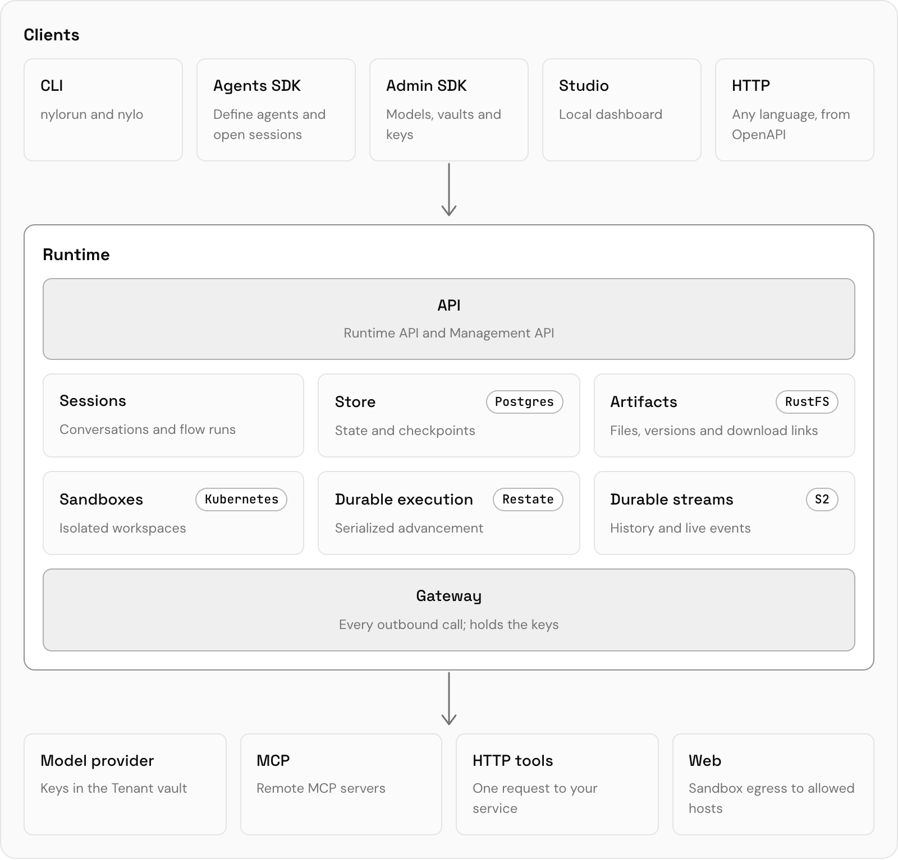

<div align="center">

# Nylorun

**The open-source runtime for AI agents.**<br>
Define agents as files. Run them on durable infrastructure you host.

[](https://github.com/nylorun/agents/actions/workflows/ci.yml)
[](https://www.npmjs.com/package/nylorun)
[](./LICENSE)
[](https://github.com/nylorun/agents/discussions)

[Docs](https://docs.nylorun.com/docs) ·
[Quickstart](#quickstart) ·
[Self-host](#self-host) ·
[Examples](./examples) ·
[API reference](https://docs.nylorun.com/reference/runtime)

</div>

> [!WARNING]
> **Beta.** APIs and on-disk formats change before 1.0. Upgrade every Nylorun
> package together and read [Compatibility](https://docs.nylorun.com/docs/compatibility)
> before you skip a release.

<p align="center">
  <picture>
    <source media="(prefers-color-scheme: dark)" srcset="./.github/assets/how-it-works-dark.png">
    
  </picture>
</p>

## Why Nylorun

- **Agents are files.** An agent is a folder of Markdown and JSON (instructions, tools,
  MCP servers, skills, triggers) or a TypeScript definition. Review it in a PR, then `apply` it.
- **Durable sessions.** Turns run on durable execution (Restate) and durable streams (S2),
  with sessions stored in Postgres.
- **Your infrastructure, your keys.** One Docker Compose stack on a laptop or a VM, or a Helm
  chart on Kubernetes. Model and tool keys stay in the gateway. Your identity provider signs
  people in.
- **Open protocols.** MCP for tools, AG-UI and A2A for apps and other agents, and an open
  [Harness API](./docs/reference/harness-api.md) to run turns in any language.

## Quickstart

You need Node.js 24 and Docker Compose v2 (on Windows, use WSL2). `npx nylorun doctor` checks both.

```sh
# 1. Start a Runtime and Studio on this machine (the first run pulls about 3 GB of images)
npx nylorun up

# 2. Pick a model provider; the key is stored in the Tenant's vault
npx nylorun tenant models set

# 3. Write an agent, check it offline, save it
npx nylorun init agents/hello
npx nylorun check agents/hello
npx nylorun apply agents/hello --agent

# 4. Talk to it
npx nylorun chat hello
```

`npx nylorun studio` signs your browser in to Studio, where you can chat and inspect sessions.
`npx nylorun down` stops the stack. Your data stays in Docker volumes.

## Define an agent

An agent folder needs one file, `AGENT.md`:

<!-- doc-test: folder hello AGENT.md -->
```md
---
name: hello
description: "Answers questions about orders."
---
You are hello. Answer briefly, and ask for the order id when you need it.
```

Tools, MCP servers, skills and triggers go next to it. `npx nylorun init agents/hello --example`
writes one of each. The same agent in TypeScript, with an HTTP tool, using the
[Agents SDK](https://docs.nylorun.com/docs/build):

<!-- doc-test: typescript -->
```ts
import { Agent, http } from "@nylorun/agents";
import { z } from "zod";

const lookupOrder = http({
  name: "lookup_order",
  description: "Look up an order by id.",
  input: z.object({ orderId: z.string() }),
  url: "https://orders.example.com/lookup",
});

export const hello = Agent({ id: "hello" })
  .instructions("Answer briefly. Use lookup_order for orders.")
  .tools(lookupOrder);
```

Next: [Tools](https://docs.nylorun.com/docs/build/tools) ·
[MCP](https://docs.nylorun.com/docs/build/mcp) ·
[Flow agents](https://docs.nylorun.com/docs/build/flows) ·
[Serve your users](https://docs.nylorun.com/docs/build#serve-your-users)

## Self-host

Everything in this repository runs without a Nylorun account.

| You want to | Start here |
| --- | --- |
| Run on one machine or VM with Docker Compose | [Deploy on a VM](https://docs.nylorun.com/docs/deploy/vm) · [Compose reference](./docs/self-hosting/docker-compose.md) |
| Sign people in with your own identity provider | [Identity and access](./docs/self-hosting/identity.md) · [Keycloak example](./examples/self-host) |
| Run on Kubernetes with pod sandboxes | [Kubernetes guide](https://docs.nylorun.com/docs/deploy/kubernetes) · [Helm chart](./charts/nylorun-runtime) |
| Collect metrics, traces and audit events | [Observability](./docs/self-hosting/observability.md) |
| Upgrade between beta releases | [Compatibility](https://docs.nylorun.com/docs/compatibility) · [Migration notes](./docs/upgrading/migration.md) |

## Documentation

Learn and build at **[docs.nylorun.com](https://docs.nylorun.com/docs)**:
[Concepts](https://docs.nylorun.com/docs/concepts) ·
[Build](https://docs.nylorun.com/docs/build) ·
[Run](https://docs.nylorun.com/docs/run/sessions) ·
[Deploy](https://docs.nylorun.com/docs/deploy/vm) ·
[Runtime API](https://docs.nylorun.com/reference/runtime) ·
[Troubleshooting](https://docs.nylorun.com/docs/troubleshooting).

Operator and contributor references live in [`docs/`](./docs) in this repository.

Using a coding agent? Point it at [`llms.txt`](https://docs.nylorun.com/llms.txt). Every docs page
is also available as Markdown: add `.md` to its URL.

## Examples

| Example | Shows |
| --- | --- |
| [`examples/agents/triage`](./examples/agents/triage) | An agent written as a folder of Markdown and JSON |
| [`examples/agents/repo-brief`](./examples/agents/repo-brief) | One flow agent with map, parallel, loop and an HTTP tool |
| [`examples/self-host`](./examples/self-host) | Keycloak and oauth2-proxy in front of a Tenant, with an end-to-end smoke |
| [`examples/harness-minimal`](./examples/harness-minimal) | Your own harness on the Harness API |
| [`examples/observability`](./examples/observability) | OpenTelemetry metrics and traces from the Runtime |

[All examples](./examples/README.md)

## Contributing

This is a TypeScript monorepo (Runtime, Studio, CLI, SDKs) with a Go sandbox service.
[`docs/reference/packages.md`](./docs/reference/packages.md) maps each folder to what it publishes.
You need Node 24 and npm 11:

```sh
git clone https://github.com/nylorun/agents.git && cd agents
npm run setup   # install and build the packages
npm run dev     # run the examples' Tenant from source, rebuilding as you edit
```

Read [CONTRIBUTING.md](./CONTRIBUTING.md) for checks and pull requests.

## Community

- [Discussions](https://github.com/nylorun/agents/discussions) for questions and ideas
- [Issues](https://github.com/nylorun/agents/issues) for bugs and feature requests
- [SECURITY.md](./.github/SECURITY.md) to report a vulnerability privately
- [Code of Conduct](./.github/CODE_OF_CONDUCT.md)

## License

[Apache-2.0](./LICENSE)
